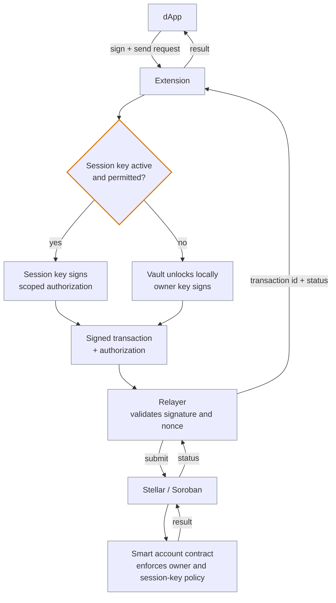

# Architecture Flow: dApp → Extension → Relayer → Blockchain

Component-level view of a single Ancore transaction: who talks to whom, and where the
signing decision is made. For the message-by-message sequence — simulation, submission,
confirmation — see [Transaction flow](TRANSACTION_FLOW.md).

No fills, text colours or diagram background are set here on purpose: Mermaid keeps those
from the active theme, so the diagram stays readable in light **and** dark mode. Only the
stroke is pinned, because the default node border is the part that disappears against a
dark background, and the decision node gets a heavier, warmer stroke so the one branch that
changes who signs is visible at a glance.

## The signing decision

Everything before the decision is the same request; everything after it is the same
submission. What differs is which key signs, and that is the branch that matters for user
safety:

| Branch | Applies when | Key material | What the relayer receives |
| --- | --- | --- | --- |
| **Session key** | A session key exists for the operation, has not expired, and covers the operation's permission | Session key — scoped and time-limited; the owner key stays in the vault | The session-key signature and public key |
| **Vault (owner approval)** | No usable session key: registering a key, an out-of-scope operation, or an expired/revoked key | Owner key, unlocked locally on the user's device | A signature the contract checks against the account owner |

Neither branch gives the relayer key material. The contract re-checks the authorization
(nonce, expiry, permissions, spend limits) on-chain, so a relayer that is compromised or
simply wrong cannot widen what the signature allows.

## Key components

| Component | Responsibility |
| --- | --- |
| **dApp** | Requests a transaction and displays the result. Never receives key material. |
| **Extension** | Presents the request, applies wallet checks (account, network, payload), and coordinates signing. |
| **Session key** | Signs only the actions its permissions and expiry cover. |
| **Vault** | Stores the owner key encrypted on the user's device and signs only after a local unlock. |
| **Relayer** | Validates the signed request and submits it to Stellar; cannot access the owner key or bypass contract policy. |
| **Blockchain (Stellar / Soroban)** | Executes the transaction and returns its status. |
| **Smart account contract** | Verifies the authorization, nonce and session-key permissions on-chain. |

## Request flow

1. The dApp asks the extension to sign and send a transaction.
2. The extension resolves the request against the account and network, then decides whether a
   session key can sign it or the owner has to approve it in the vault.
3. The signed transaction and its authorization are sent to the relayer.
4. The relayer validates the signature and nonce and submits to Stellar.
5. Stellar executes the call; the smart account contract enforces owner and session-key policy.
6. Confirmation travels back: contract → Stellar → relayer → extension → dApp.

## Related

- [Transaction flow (sequence diagram)](TRANSACTION_FLOW.md) — the same path message by message, including simulation and Horizon submission.
- [System overview](OVERVIEW.md) — components and their subsystems.
- [Session-key lifecycle](../examples/session-key-lifecycle.md) — creating, using and revoking a scoped authorization.
